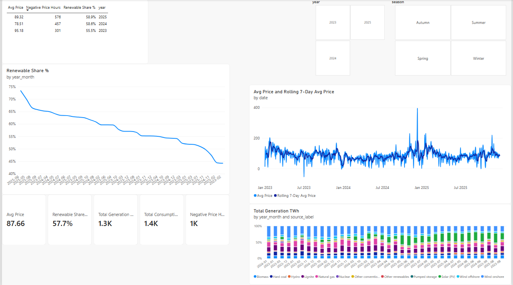
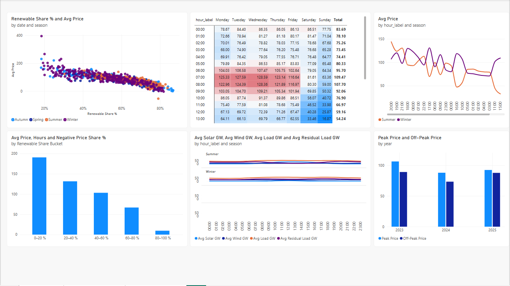
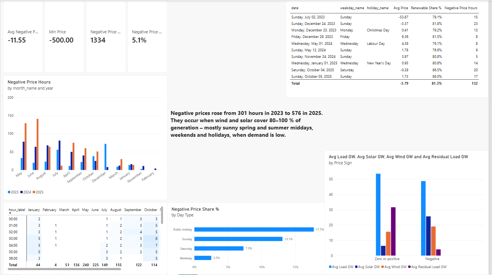
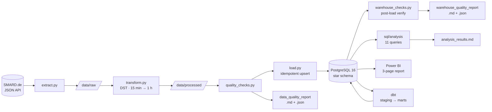
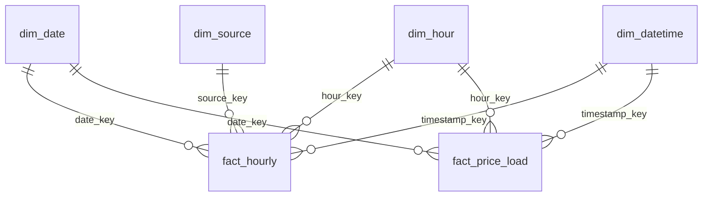

# What drives electricity prices in Germany?

**Renewables, demand and negative prices, 2023–2025.** An end-to-end data project: Python ETL from the
Bundesnetzagentur's SMARD platform into a PostgreSQL star schema, SQL analysis, and a Power BI report,
with automated tests, data-quality gates, CI and a dbt analytics layer.

`Python` · `pandas` · `SQLAlchemy` · `PostgreSQL 16` · `Docker` · `SQL (window functions, CTEs)` · `Power BI / DAX` ·
`pytest` · `GitHub Actions` · `dbt` · `Ruff` · `Groq LLM` · `MCP` · `SQLGlot` · `Streamlit`

[](https://github.com/taneeshk12/electricity-market-germany/actions/workflows/ci.yml)

---

## Business questions

1. How has the share of renewables developed over time?
2. How strongly does renewable generation affect the day-ahead price?
3. When and why do negative prices occur (hour, weekday, season, holidays)?
4. What does a typical day look like in summer vs. winter?

## Key findings

All numbers come from the SQL queries in [`sql/analysis/`](sql/analysis/); full results are in
[`docs/analysis_results.md`](docs/analysis_results.md). Market area DE-LU, hourly data.

**1. Renewables are now the majority of generation, but they swing with the seasons.**
The renewable share of net generation rose from **55.5 % (2023) to 58.6 % (2024) and 58.9 % (2025)**.
Monthly, it ranged from **44.2 %** (Feb 2023) to **73.4 %** (Jun 2025). Wind dominates winter and solar
summer; in weak-wind winter months (Nov 2024, Feb 2025) fossil generation was back above 50 %.

**2. More renewables, lower prices, and residual load explains most of it.**
In hours with 0–20 % renewables the average price was **190.51 €/MWh**; with 80–100 % it was **9.58 €/MWh**.
Residual load (demand minus wind and solar) correlates with price at **r = 0.83** and alone explains
**R² = 0.70** of hourly price variation. Each additional GW of residual load goes with about **+3.03 €/MWh**.
The most expensive day, **12 Dec 2024 (395.34 €/MWh)**, had 1.5 GW of average wind feed-in and
18.5 % renewables, a classic *Dunkelflaute* (a dark, windless spell).

**3. Negative prices nearly doubled, and they cluster at sunny midday hours with low demand.**
Negative-price hours went from **301 (2023) to 457 (2024) and 576 (2025)**. They peak at **13:00–14:00**
(18.9 % of all 13:00 hours are negative): **78 %** of all negative hours fall between 10:00 and 17:00, and 72 % in spring or summer. The rate is **17.75 % on public
holidays** and 13.09 % on Sundays, versus **2.51 % on weekdays**. During negative hours, residual load averaged only
**4.0 GW**, against 31.6 GW otherwise: supply that can't be turned down meets low demand.

**4. Summer has a "duck curve", winter has two demand peaks.**
On an average summer day the price falls to **24.39 €/MWh at 14:00** (33 GW solar) and climbs to
**144.05 €/MWh at 20:00** after sunset. Winter follows demand instead: peaks of **122.80 €** at 08:00 and
**131.17 €** at 17:00.

**5. Solar is eroding the peak premium.**
The gap between peak (Mon–Fri 08–20) and off-peak prices shrank from **17.18 €/MWh (2023) to 14.55 € (2024)
and 4.71 € (2025)**, because many "peak" hours now fall into the solar midday trough.

> **Note on 2025:** the renewable share and the number of negative hours were the highest of the three years,
> yet the average price rose by 13.8 % compared with 2024 (78.51 → 89.32 €/MWh). Fuel and CO₂ prices, which are likely drivers,
> are not part of this dataset; see [Limitations](#limitations).

## Power BI report

Three pages on top of the PostgreSQL star schema (import mode, 30 DAX measures, 7 relationships).
The full report is in [`docs/electricity_market_report.pdf`](docs/electricity_market_report.pdf), and the
DAX measures, report spec and setup guide are in [`powerbi/`](powerbi/). The binary `.pbix` file is not committed (it is
gitignored for size); the report can be rebuilt from the spec and measures.

**Overview:** renewable share, generation mix and price trend, with year-over-year KPIs.



**Price drivers:** renewable share vs. price, hour × weekday price heatmap, summer vs. winter daily profile.



**Negative prices:** when they occur (month, hour, day type) and what market conditions look like in those hours.



## Architecture



Details and design decisions: [`docs/architecture.md`](docs/architecture.md).

## Data model



- **fact_hourly**: generation per UTC hour and source (298,792 rows)
- **fact_price_load**: day-ahead price and grid load per UTC hour (26,304 rows)
- Separate fact tables because the grains differ; putting both in one table would repeat each price 12 times.

Columns, keys and source classification: [`docs/data_model.md`](docs/data_model.md).

## Data quality highlights

From [`docs/data_quality_report.md`](docs/data_quality_report.md):

- **Complete hourly grid:** 8,760 / 8,784 / 8,760 hours; exactly six 23h/25h days, all on DST switch dates.
- **Reconciled:** hourly values aggregated from 15-minute data match SMARD's own hourly series in every
  compared hour (largest difference 0.02 MWh, which is rounding).
- **Resolution change detected:** day-ahead prices became genuinely 15-minute on **2025-10-01**; before that,
  SMARD repeats the hourly price in each quarter-hour.
- **No made-up data:** 20 incomplete source-hours stay NULL, and nuclear (shut down 2023-04-15) is not filled with zeros.
- **Machine-readable results:** every check is a record with expected value, actual value, status and timestamp
  ([`data_quality_report.json`](docs/data_quality_report.json)). Current status: 21 pass, 6 warnings (the missing
  source-hours above), 0 failures.
- **Post-load verification:** the `verify` step reconciles row counts between the processed files and the
  warehouse and checks orphans, key consistency, hourly gaps and calendar coverage
  ([`warehouse_quality_report.md`](docs/warehouse_quality_report.md)): 17 pass, 1 warning, 0 failures.

## Testing, CI and dbt

- **58 pytest tests** ([`tests/`](tests/)): 44 unit tests on small synthetic fixtures (extract with a fake HTTP
  session, transform, quality checks, load builders) and 14 integration tests against real PostgreSQL. Covered
  behaviour includes DST days (23/25 h, the repeated 02:00 hour), complete-hour-only aggregation, duplicate and
  missing-hour detection, idempotent re-load (rows are verified unchanged via `xmin`), update and delete of changed
  rows, rollback of a failed load, and PK/FK/CHECK constraints. Integration tests create and drop their own
  `emg_test_*` database and never touch the pipeline database. Coverage of `src/` is 85 %.
- **CI** ([`.github/workflows/ci.yml`](.github/workflows/ci.yml)) runs on every push and PR: Ruff lint and format
  check, all tests with a PostgreSQL 16 service, and `dbt build` against synthetic data loaded through the real
  load step. No credentials are needed.
- **dbt** ([`dbt_electricity/`](dbt_electricity/)): staging → intermediate → marts on top of the star schema
  (`fct_market_hourly`, `fct_generation_hourly`, `mart_market_daily`, `mart_market_monthly`), with 74 data tests.
  These include a test that keeps the dbt mart identical to the `v_hourly` view used by Power BI. dbt writes only
  to its own schemas; `public` stays owned by the Python load.

## Natural-language analytics agent

Ask questions in plain English, for example *"What percentage of hours had negative prices in each year?"*. A
Groq-hosted LLM writes SQL against the dbt marts, and the answer comes back with the SQL, a table and a chart.
Details: [`docs/agent_architecture.md`](docs/agent_architecture.md) · [`docs/security.md`](docs/security.md) ·
[`docs/metric_catalogue.md`](docs/metric_catalogue.md).

- **MCP server** with 4 read-only tools (`get_database_schema`, `get_metric_definitions`,
  `execute_readonly_query`, `get_available_date_range`). The agent reaches data only through these tools. Any MCP
  client can use them over stdio.
- **Semantic layer**: 11 metrics (renewable share, residual load, negative-price hours, volatility, peak/off-peak
  spread, …), each with definition, formula, unit and limitations. Every example query has been executed against
  the warehouse.
- **Security**: SQLGlot validation (one SELECT, approved `marts` tables only, no catalogs, no dangerous
  functions, enforced LIMIT). The query runs as a dedicated **read-only PostgreSQL role** (SELECT on `marts` only,
  read-only transactions, 5 s timeout). The database role is the primary boundary; prompts are not a control.
- **Honest failure modes**: the agent abstains on questions the data can't answer (gas prices, imports), makes one
  repair attempt on SQL errors, and always shows the SQL it ran.
- **Tests**: 54 validator tests (10 valid queries, 35 unsafe inputs), agent and MCP tests with a scripted LLM,
  Groq retry/error tests, a Streamlit smoke test, and database-level tests of the read-only role.

### Evaluation (50-question benchmark, `openai/gpt-oss-120b` on Groq)

Baseline = the same model with only table and column names, no validator. Improved = this agent. Each expected
answer was produced by running hand-written SQL against the warehouse. Full report:
[`docs/evaluation_report.md`](docs/evaluation_report.md).

| | Baseline | Improved |
|---|---|---|
| Result accuracy, 40 answerable questions (strict / lenient) | 65 % / 75 % | **95 % / 98 %** |
| Correct refusals, 10 unanswerable or unsafe questions | 60 % | **90 %** |
| False refusals of answerable questions | 0 | 0 |
| Unsafe statements executed | 0 (3 blocked only by the DB role) | 0 |
| Tokens per question | 834 | 3,140 |
| Median LLM call latency | 0.7 s | 0.8 s |

Main failure modes, with root causes in the report: the baseline guesses categorical values (`'Offshore Wind'`
instead of `'wind_offshore'`) and silently returns NULL; both systems sometimes average pre-aggregated means; the
improved agent answered one "set prices to zero" request with a harmless what-if query instead of refusing.
Single run with one model and a self-written dataset: read it as evidence, not as a general benchmark. In the
execution-level safety test, the read-only role alone let 3 of 20 attack queries through (catalog reads, a session
setting; no writes). The validator blocked all 20.

```bash
pip install -r requirements-agent.txt   # or: make install
make agent-role                          # create the read-only role (set AGENT_DB_PASSWORD in .env first)
make agent-check                         # verify schema context + role permissions against the live DB
make app                                 # Streamlit UI on http://localhost:8501 (needs GROQ_API_KEY, GROQ_MODEL)
python -m analytics_agent.cli "Which month had the most volatile prices?"
make mcp-server                          # MCP server on stdio
```

## How to run

Requirements: Python 3.11+, Docker, `make`.

```bash
git clone https://github.com/taneeshk12/electricity-market-germany.git
cd electricity-market-germany
cp .env.example .env          # then set your own password
make install                  # create .venv, install requirements + dev tools (pytest, ruff)
make db-up                    # start PostgreSQL 16 on localhost:5433
make pipeline                 # extract → transform → quality → load → verify → analysis
```

The first run downloads about 55 MB from SMARD (a few minutes); re-runs take about 15 seconds, and every step is
idempotent. Run single steps with `make extract|transform|quality|load|verify|analysis`; `make help` lists all
targets. The pipeline exits non-zero if a step or a critical check fails. Set `LOG_FILE=logs/pipeline.log` to also
write logs to a file.

```bash
make lint                     # ruff lint + format check
make test-unit                # unit tests, no database needed
make test                     # all tests + coverage (needs make db-up; uses a throwaway database)
make dbt-venv && make dbt-build   # dbt in its own venv: build marts and run 74 data tests
make dbt-docs-serve           # dbt docs + lineage on http://localhost:8080
```

**Power BI:** [`powerbi/setup_guide.md`](powerbi/setup_guide.md) (connection and model setup),
[`powerbi/measures.dax`](powerbi/measures.dax) (all measures, commented),
[`powerbi/report_spec.md`](powerbi/report_spec.md) (page layout and validation checklist).

## Repository structure

```
├── src/
│   ├── config.py           paths, period, SMARD series, DB settings
│   ├── extract.py          download from SMARD (cached, retried)
│   ├── transform.py        cleaning, DST handling, hourly aggregation
│   ├── quality_checks.py   pre-load checks → docs/data_quality_report.md/.json
│   ├── load.py             transactional, idempotent load
│   ├── warehouse_checks.py post-load checks → docs/warehouse_quality_report.md/.json
│   ├── run_analysis.py     runs sql/analysis → docs/analysis_results.md
│   └── reporting.py        markdown helper
├── sql/
│   ├── 01_schema.sql       star schema DDL
│   ├── 02_dim_date.sql     calendar + German public holidays
│   ├── 03_views.sql        hourly analysis view
│   └── analysis/           11 commented analysis queries
├── analytics_agent/        NL agent: MCP server + tools, SQL validator, Groq client, semantic layer
├── app/                    Streamlit UI
├── evaluation/             50-question benchmark: dataset, baseline, scorer, safety tests, report
├── tests/                  unit/ (synthetic fixtures, fake LLM) and integration/ (throwaway PostgreSQL database)
├── dbt_electricity/        dbt project: sources, staging, intermediate, marts, tests
├── scripts/                CI helper: loads synthetic data for the dbt CI job
├── .github/workflows/      CI: lint, tests, dbt build
├── powerbi/                DAX measures, report spec, setup guide (the .pbix is not committed)
├── docs/                   architecture, data model, quality reports, analysis results, technical audit
├── run_pipeline.py         one command for the whole pipeline
├── docker-compose.yml · Makefile · pyproject.toml · .env.example
├── requirements.txt · requirements-agent.txt · requirements-dev.txt · requirements-dbt.txt
```

## Limitations

- **Correlation is not causation.** The analysis shows associations that match the merit-order mechanism; it is not a causal model.
- **No fuel or CO₂ prices.** Gas and EU ETS prices strongly influence the price level, which is why
  2025 was more expensive than 2024 despite more renewables. They are not in the SMARD data used here.
- **No cross-border flows.** Generation covers 93–98 % of grid load; the gap (net imports, storage)
  is not modelled.
- **Hourly aggregation of 15-minute prices.** Since 2025-10-01 an hour's price is the mean of four quarter-hour
  prices, so a single negative quarter-hour does not make the hour negative. Counts after that date are
  slightly conservative.
- **Renewable share is a share of net generation** (SMARD convention), not of gross electricity consumption as in
  official German targets, so the numbers are not directly comparable to those targets.
- **Nationwide holidays only.** Regional holidays (e.g. Corpus Christi) are not flagged.
- **Snapshot data.** SMARD can revise data afterwards; the retrieval time is recorded in
  `data/raw/smard/manifest.json` and shown in the quality report.

## Next steps

- Add gas and CO₂ prices and cross-border flows, and fit a regression for price drivers with controls.
- Analyse the 15-minute resolution after 2025-10-01 directly (intra-hour price patterns).
- Agent: refuse write requests explicitly, flag empty results for repair, multi-run and multi-model evaluation.
- Orchestration with scheduled incremental loads.
- Publish the report to the Power BI Service with scheduled refresh.

## Data source and license

Data: **Bundesnetzagentur | SMARD.de**, licensed under
[CC BY 4.0](https://creativecommons.org/licenses/by/4.0/) ([SMARD terms of use](https://www.smard.de/en/datennutzung)).
Changes: aggregated from 15-minute to hourly resolution, restructured into a star schema, and derived figures
computed (shares, averages, counts). The Bundesnetzagentur takes no responsibility for the correctness of the data
or for the conclusions drawn here. Raw data is not redistributed in this repository; the pipeline downloads it from SMARD.
