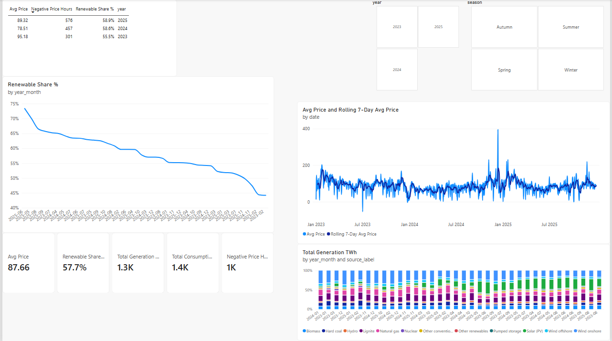
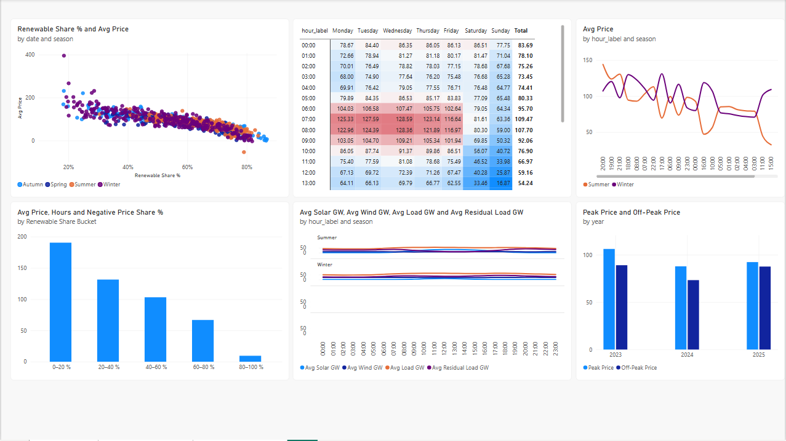
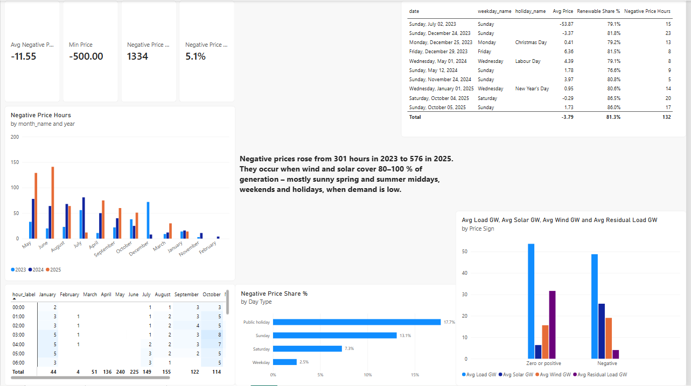
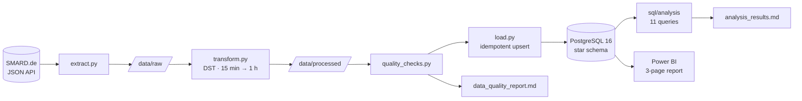
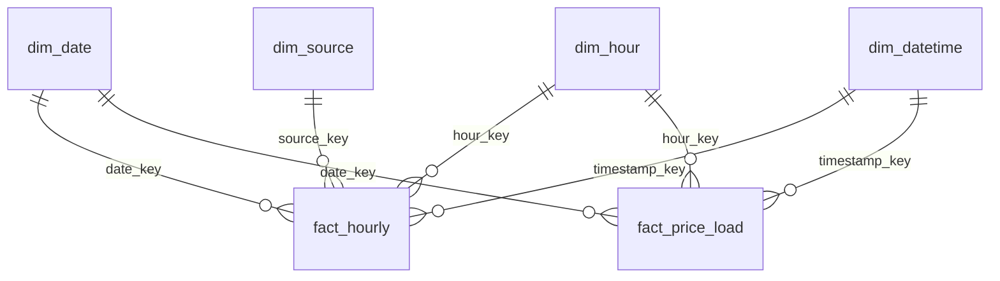

# What drives electricity prices in Germany?

**Renewables, demand and negative prices, 2023–2025.** An end-to-end data project: Python ETL from the
Bundesnetzagentur's SMARD platform into a PostgreSQL star schema, SQL analysis, and a Power BI report.

`Python` · `pandas` · `SQLAlchemy` · `PostgreSQL 16` · `Docker` · `SQL (window functions, CTEs)` · `Power BI / DAX`

---

## Business questions

1. How has the share of renewables developed over time?
2. How strongly does renewable generation affect the day-ahead price?
3. When and why do negative prices occur (hour, weekday, season, holidays)?
4. What does a typical day look like in summer vs. winter?

## Key findings

All numbers come from the SQL queries in [`sql/analysis/`](sql/analysis/); full results are in
[`docs/analysis_results.md`](docs/analysis_results.md). Market area DE-LU, hourly data.

**1. Renewables are now the majority of generation, but they swing with the seasons.**
The renewable share of net generation rose from **55.5 % (2023) to 58.6 % (2024) and 58.9 % (2025)**.
Monthly, it ranged from **44.2 %** (Feb 2023) to **73.4 %** (Jun 2025). Wind dominates winter and solar
summer; in weak-wind winter months (Nov 2024, Feb 2025) fossil generation was back above 50 %.

**2. More renewables, lower prices, and residual load explains most of it.**
In hours with 0–20 % renewables the average price was **190.51 €/MWh**; with 80–100 % it was **9.58 €/MWh**.
Residual load (demand minus wind and solar) correlates with price at **r = 0.83** and alone explains
**R² = 0.70** of hourly price variation. Each additional GW of residual load goes with about **+3.03 €/MWh**.
The most expensive day, **12 Dec 2024 (395.34 €/MWh)**, had 1.5 GW of average wind feed-in and
18.5 % renewables, a classic *Dunkelflaute* (a dark, windless spell).

**3. Negative prices nearly doubled, and they cluster at sunny midday hours with low demand.**
Negative-price hours went from **301 (2023) to 457 (2024) and 576 (2025)**. They peak at **13:00–14:00**
(18.9 % of all 13:00 hours are negative): **78 %** of all negative hours fall between 10:00 and 17:00, and 72 % in spring or summer. The rate is **17.75 % on public
holidays** and 13.09 % on Sundays, versus **2.51 % on weekdays**. During negative hours, residual load averaged only
**4.0 GW**, against 31.6 GW otherwise: supply that can't be turned down meets low demand.

**4. Summer has a "duck curve", winter has two demand peaks.**
On an average summer day the price falls to **24.39 €/MWh at 14:00** (33 GW solar) and climbs to
**144.05 €/MWh at 20:00** after sunset. Winter follows demand instead: peaks of **122.80 €** at 08:00 and
**131.17 €** at 17:00.

**5. Solar is eroding the peak premium.**
The gap between peak (Mon–Fri 08–20) and off-peak prices shrank from **17.18 €/MWh (2023) to 14.55 € (2024)
and 4.71 € (2025)**, because many "peak" hours now fall into the solar midday trough.

> **Note on 2025:** the renewable share and the number of negative hours were the highest of the three years,
> yet the average price rose by 13.8 % compared with 2024 (78.51 → 89.32 €/MWh). Fuel and CO₂ prices, which are likely drivers,
> are not part of this dataset; see [Limitations](#limitations).

## Power BI report

Three pages on top of the PostgreSQL star schema (import mode, 30 DAX measures, 7 relationships).
The full report is in [`docs/electricity_market_report.pdf`](docs/electricity_market_report.pdf), and the
Power BI project (`.pbip`, text-based, so it can be diffed) is in [`powerbi/`](powerbi/).

**Overview:** renewable share, generation mix and price trend, with year-over-year KPIs.



**Price drivers:** renewable share vs. price, hour × weekday price heatmap, summer vs. winter daily profile.



**Negative prices:** when they occur (month, hour, day type) and what market conditions look like in those hours.



## Architecture



Details and design decisions: [`docs/architecture.md`](docs/architecture.md).

## Data model



- **fact_hourly**: generation per UTC hour and source (298,792 rows)
- **fact_price_load**: day-ahead price and grid load per UTC hour (26,304 rows)
- Separate fact tables because the grains differ; putting both in one table would repeat each price 12 times.

Columns, keys and source classification: [`docs/data_model.md`](docs/data_model.md).

## Data quality highlights

From [`docs/data_quality_report.md`](docs/data_quality_report.md):

- **Complete hourly grid:** 8,760 / 8,784 / 8,760 hours; exactly six 23h/25h days, all on DST switch dates.
- **Reconciled:** hourly values aggregated from 15-minute data match SMARD's own hourly series in every
  compared hour (largest difference 0.02 MWh, which is rounding).
- **Resolution change detected:** day-ahead prices became genuinely 15-minute on **2025-10-01**; before that,
  SMARD repeats the hourly price in each quarter-hour.
- **No made-up data:** 20 incomplete source-hours stay NULL, and nuclear (shut down 2023-04-15) is not filled with zeros.

## How to run

Requirements: Python 3.11+, Docker, `make`.

```bash
git clone https://github.com/taneeshk12/electricity-market-germany.git
cd electricity-market-germany
cp .env.example .env          # then set your own password
make venv                     # create .venv and install requirements
make db-up                    # start PostgreSQL 16 on localhost:5433
make pipeline                 # extract → transform → quality → load → analysis
```

The first run downloads about 55 MB from SMARD (a few minutes); re-runs take about 15 seconds, and every step is
idempotent. Run single steps with `make extract|transform|quality|load|analysis`; `make help` lists all targets.

**Power BI:** [`powerbi/setup_guide.md`](powerbi/setup_guide.md) (connection and model setup),
[`powerbi/measures.dax`](powerbi/measures.dax) (all measures, commented),
[`powerbi/report_spec.md`](powerbi/report_spec.md) (page layout and validation checklist).

## Repository structure

```
├── src/
│   ├── config.py           paths, period, SMARD series, DB settings
│   ├── extract.py          download from SMARD (cached, retried)
│   ├── transform.py        cleaning, DST handling, hourly aggregation
│   ├── quality_checks.py   checks → docs/data_quality_report.md
│   ├── load.py             transactional, idempotent load
│   ├── run_analysis.py     runs sql/analysis → docs/analysis_results.md
│   └── reporting.py        markdown helper
├── sql/
│   ├── 01_schema.sql       star schema DDL
│   ├── 02_dim_date.sql     calendar + German public holidays
│   ├── 03_views.sql        hourly analysis view
│   └── analysis/           11 commented analysis queries
├── powerbi/                Power BI project (.pbip), DAX measures, report spec, setup guide
├── docs/                   architecture, data model, quality report, analysis results
├── run_pipeline.py         one command for the whole pipeline
├── docker-compose.yml · Makefile · requirements.txt · .env.example
```

## Limitations

- **Correlation is not causation.** The analysis shows associations that match the merit-order mechanism; it is not a causal model.
- **No fuel or CO₂ prices.** Gas and EU ETS prices strongly influence the price level, which is why
  2025 was more expensive than 2024 despite more renewables. They are not in the SMARD data used here.
- **No cross-border flows.** Generation covers 93–98 % of grid load; the gap (net imports, storage)
  is not modelled.
- **Hourly aggregation of 15-minute prices.** Since 2025-10-01 an hour's price is the mean of four quarter-hour
  prices, so a single negative quarter-hour does not make the hour negative. Counts after that date are
  slightly conservative.
- **Renewable share is a share of net generation** (SMARD convention), not of gross electricity consumption as in
  official German targets, so the numbers are not directly comparable to those targets.
- **Nationwide holidays only.** Regional holidays (e.g. Corpus Christi) are not flagged.
- **Snapshot data.** SMARD can revise data afterwards; the retrieval time is recorded in
  `data/raw/smard/manifest.json` and shown in the quality report.

## Next steps

- Add gas and CO₂ prices and cross-border flows, and fit a regression for price drivers with controls.
- Analyse the 15-minute resolution after 2025-10-01 directly (intra-hour price patterns).
- Tests (`pytest` for transform logic) and CI with GitHub Actions.
- Orchestration (Airflow or Prefect) with daily incremental loads; dbt for the SQL layer.
- Publish the report to the Power BI Service with scheduled refresh.

## Data source and license

Data: **Bundesnetzagentur | SMARD.de**, licensed under
[CC BY 4.0](https://creativecommons.org/licenses/by/4.0/) ([SMARD terms of use](https://www.smard.de/en/datennutzung)).
Changes: aggregated from 15-minute to hourly resolution, restructured into a star schema, and derived figures
computed (shares, averages, counts). The Bundesnetzagentur takes no responsibility for the correctness of the data
or for the conclusions drawn here. Raw data is not redistributed in this repository; the pipeline downloads it from SMARD.
