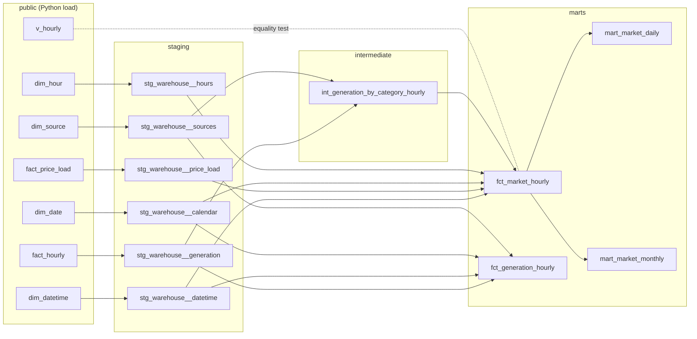

# dbt project: `electricity`

Analytics layer on top of the star schema that the Python pipeline loads into PostgreSQL.

- **Reads** schema `public` (owned by `src/load.py`) and **writes only** to its own schemas
  `staging`, `intermediate` and `marts`. It cannot break the load, Power BI or `sql/analysis`.
- `public.v_hourly` stays the source for Power BI. `marts.fct_market_hourly` reproduces it with calendar
  attributes added, and a test keeps the two identical row for row.

## Lineage



## Models

| Model | Grain | Materialisation | Purpose |
|---|---|---|---|
| `stg_warehouse__*` (6) | as source | view | 1:1 selects with light renames (`week` → `iso_week`, `weekday` → `iso_weekday`) |
| `int_generation_by_category_hourly` | UTC hour | view | generation pivoted to total / renewable / variable renewable / solar / wind / fossil |
| `fct_market_hourly` | UTC hour | table | price, load, mix, renewable share, residual load, local calendar |
| `fct_generation_hourly` | UTC hour × source | table | long-format generation with source label and category |
| `mart_market_daily` | local date | table | daily price stats, negative hours, load, renewable share |
| `mart_market_monthly` | local month | table | price level and volatility, peak/off-peak, negative-hour share, mix |

## Business definitions

| Term | Definition |
|---|---|
| Renewable share | `SUM(renewable_mwh) / SUM(total_gen_mwh)`, energy-weighted, share of **net generation** (SMARD convention, not gross consumption) |
| Residual load | `consumption_mwh − (wind + solar generation)` |
| Negative-price hour | hourly day-ahead price `< 0` (since 2025-10-01 the hour is a mean of four quarter-hours) |
| Peak | Mon–Fri 08:00–20:00 local time (EEX); public holidays are not excluded |
| Price volatility | sample standard deviation of hourly prices within the month |
| Peak hourly load | maximum hourly grid load (MWh in one hour = average MW) |

## Tests

- **Source tests (on the warehouse itself):** unique and not-null keys, all FK relationships, composite PK of
  `fact_hourly`, price within the SDAC limits [−500, 4000], non-negative generation and load, accepted values
  for `utc_offset_h`, `season` and `category`.
- **Model tests:** unique/not-null keys, `renewable_share` and `negative_price_hour_share` in [0, 1], local hour
  in [0, 23], daily `hours` ∈ {23, 24, 25}.
- **Singular tests (`tests/`):**
  - `assert_fct_market_hourly_matches_v_hourly`: the mart equals the existing view.
  - `assert_irregular_days_are_dst_switch_days`: only the last Sunday of Mar (23 h) or Oct (25 h) can deviate from 24 h.
  - `assert_hourly_grid_has_no_gaps`: consecutive UTC hours are exactly 1 hour apart.
  - `assert_monthly_mart_reconciles_with_facts`: monthly totals equal the fact tables' totals.
  - `assert_generation_mart_matches_category_totals`: the long and pivoted generation agree.
- Generic tests `accepted_range` and `unique_combination` are small local macros, so no `dbt deps` download is needed.

Result on the real warehouse (2026-11-12): `PASS=85 WARN=0 ERROR=0` (11 models, 74 tests).
CI runs the same `dbt build` against synthetic data loaded through the real `load.py`.

## Running

dbt has its own virtualenv so its dependencies cannot conflict with the pipeline.

```bash
make dbt-venv        # once: .venv-dbt with dbt-core 1.11 + dbt-postgres 1.10
make dbt-debug       # creates profiles.yml from profiles.example.yml, tests the connection
make dbt-build       # build models + run all tests
make dbt-docs-serve  # documentation and lineage graph on http://localhost:8080
```

`profiles.yml` holds no secrets. It reads `POSTGRES_*` from the environment, which `make` exports from `.env`.
It is gitignored anyway, so local edits are never committed.

## Known limitations

- Hours where a single source is missing (15 hours in 2023–2025) have a slightly understated total generation,
  exactly as in `v_hourly`.
- No source freshness checks: the warehouse is a fixed 2023–2025 snapshot.
- No seeds: reference data is owned by `sql/01_schema.sql` and `sql/02_dim_date.sql` and is not duplicated here.
