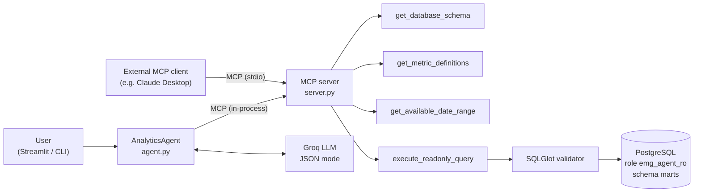
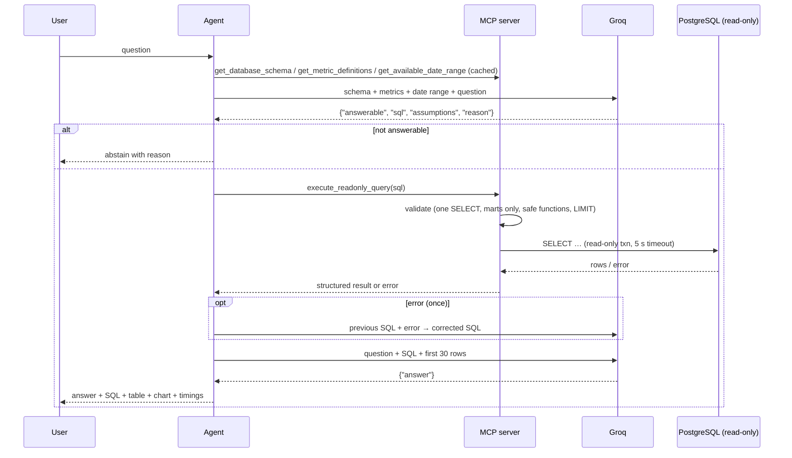

# Analytics agent architecture



## Execution flow



## Components

| Module | Responsibility |
|---|---|
| `config.py` | environment-based settings; secrets hidden from reprs; refuses to use the admin user |
| `schema_context.py` | the 4 approved mart tables with curated column descriptions; drift check against `information_schema` |
| `metrics.py` | semantic layer: 11 metrics, each with definition, formula, tables, columns, unit, limitations and verified example SQL ([catalogue](metric_catalogue.md)) |
| `sql_validator.py` | SQLGlot-based allowlist validation and LIMIT enforcement ([security](security.md)) |
| `db.py` / `db_role.py` | read-only execution and JSON-safe results; creation of the role |
| `llm.py` | Groq JSON-mode wrapper: retries with backoff and `retry-after`, fail-fast on auth or model errors, output parsing |
| `sql_generator.py` | prompts; pydantic validation of the model's JSON |
| `agent.py` | orchestration, one repair attempt, token and latency accounting |
| `server.py`, `tools/` | MCP server (MCP Python SDK 2.x `MCPServer`), 4 read-only tools |
| `cli.py` | ask from the terminal, list Groq models, `--check`, `--verify-metrics` |
| `app/streamlit_app.py` | UI: examples, coverage, answer, SQL, table, automatic chart, timings, limitations |

## Design decisions

- **No agent framework.** The flow is a fixed pipeline with one repair step. That makes it easy to test, debug and
  evaluate. A free-form tool-calling loop would add nondeterminism without adding capability for this task.
- **MCP as the data-access boundary.** The agent reaches data *only* through the MCP tools, through an
  in-process MCP client. External MCP clients get exactly the same tools and safeguards over stdio. MCP is an
  integration choice; it does not by itself make the SQL more correct.
- **Marts, not raw facts.** The model sees denormalised `marts.*` tables with business-level column names. This
  reduces join errors and keeps raw tables out of reach.
- **Abstention is a first-class outcome.** The model must say `answerable: false` when the data is missing (gas
  prices, imports, other countries) instead of guessing.
- **Model is configurable** through `GROQ_MODEL`. Run `python -m analytics_agent.cli --models` to list models
  available to your key.

## Using the MCP server from an MCP client

```json
{
  "mcpServers": {
    "electricity-market-germany": {
      "command": "/ABSOLUTE/PATH/electricity-market-germany/.venv/bin/python",
      "args": ["-m", "analytics_agent.server"],
      "cwd": "/ABSOLUTE/PATH/electricity-market-germany"
    }
  }
}
```

The server reads `AGENT_DB_*` and `POSTGRES_HOST/PORT/DB` from the project's `.env`. It needs no Groq key: the
client's own model writes the SQL, and the server still validates it and runs it read-only.
