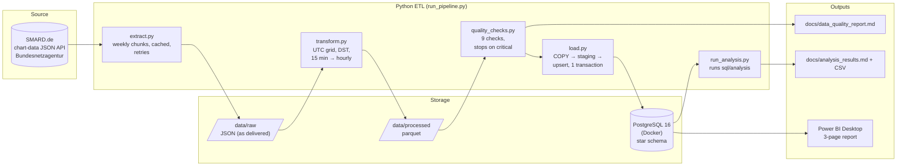

# Architecture

## Steps

| Step | What it does | Idempotency |
|---|---|---|
| **extract** | Downloads 14 SMARD series (12 generation sources, grid load, DE-LU day-ahead price) in quarter-hour resolution, plus SMARD's hourly series for reconciliation. Writes chunks atomically; records provenance in `manifest.json`. | Chunks already on disk are skipped. |
| **transform** | Keys everything on UTC hours, derives Europe/Berlin local time + UTC offset, detects the resolution, sums volumes / averages prices to hours (only complete hours), reshapes generation to long format. | Pure function of the raw files. |
| **quality** | Row counts, DST days, missing hours, duplicates, negative generation, price limits and outliers, reconciliation against SMARD hourly values, resolution detection, generation-vs-load balance. Writes the report, fails on critical issues. | Read-only. |
| **load** | Applies DDL, fills `dim_date` (holidays cross-checked with the Python `holidays` package), syncs `dim_datetime` and both facts via COPY + `INSERT … ON CONFLICT` + stale-row delete. | Re-run changes 0 rows; failure rolls back. |
| **analysis** | Executes every `sql/analysis/*.sql`, saves CSV + markdown. | Read-only. |

## Key design decisions

1. **JSON API instead of the CSV portal.** It can be automated and delivers epoch timestamps and plain numbers,
   which avoids German number formats (`1.234,5`), `;` separators and ambiguous local timestamps.
2. **UTC as the primary time key.** A DST day becomes 23 or 25 consecutive UTC hours, with no special cases.
   Local date and hour are reporting attributes only.
3. **Download quarter-hours, aggregate ourselves, reconcile against SMARD.** This makes the resolution change
   visible (15-minute day-ahead prices from 2025-10-01) and proves the aggregation is correct (0 mismatches).
4. **Never fill missing data.** Incomplete hours stay NULL and rows without a value are not loaded. Every gap
   is listed in the quality report.
5. **Two fact tables.** Generation is per hour × source and price/load is per hour, so mixing them would
   duplicate prices 12 times.
