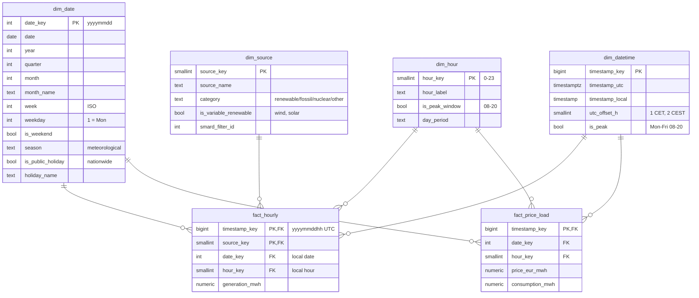

# Data model

Star schema in PostgreSQL (DDL: [`sql/01_schema.sql`](../sql/01_schema.sql), calendar:
[`sql/02_dim_date.sql`](../sql/02_dim_date.sql), analysis view: [`sql/03_views.sql`](../sql/03_views.sql)).

## Tables

| Table | Grain | Rows | Notes |
|---|---|---|---|
| fact_hourly | UTC hour × source | 298,792 | 12 sources × 26,304 h minus 16,856 rows without a value (nuclear after its series ended, 20 incomplete hours) |
| fact_price_load | UTC hour | 26,304 | complete; price NUMERIC(10,4) because post-Oct-2025 hours are means of 4 quarter-hour prices |
| dim_date | local day | 1,096 | 27 holidays (9 nationwide × 3 years), computed in SQL from an Easter function |
| dim_hour | local hour of day | 24 | |
| dim_source | generation source | 12 | fixed keys; pumped storage = `other`, "other conventional" = `fossil` |
| dim_datetime | UTC hour | 26,304 | peak flag; unique even on the 25-hour DST day |

## Source classification

| Category | Sources |
|---|---|
| renewable (variable) | wind onshore, wind offshore, solar |
| renewable | biomass, hydro, other renewables |
| fossil | lignite, hard coal, natural gas, other conventional |
| nuclear | nuclear (last generation 2023-04-15) |
| other | pumped storage (a storage technology, not primary generation) |
