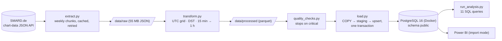

# Technical audit

Audit date: 2026-11-12, at commit `81651ca` (clean working tree, branch `main`).
Every statement below was checked against the files and the running database, not taken from the README.

## 1. Current architecture

`run_pipeline.py` runs the steps in order; the Makefile wraps each step. PostgreSQL 16 runs in Docker
Compose (`postgres:16-alpine`, named volume `pgdata`, host port 5433, healthcheck). The schema is created by
`load.py` (`CREATE … IF NOT EXISTS`), not by Docker init scripts.

### Warehouse, as verified in the database

| Object | Type | Rows | Notes |
|---|---|---|---|
| `fact_hourly` | table | 298,792 | PK (timestamp_key, source_key); FKs to all four dims; CHECK generation ≥ 0 |
| `fact_price_load` | table | 26,304 | PK timestamp_key; FKs to dim_datetime/date/hour |
| `dim_datetime` | table | 26,304 | UTC hour 2022-12-31 23:00Z – 2025-12-31 22:00Z (= local 2023-01-01 – 2025-12-31) |
| `dim_date` | table | 1,096 | local calendar + 9 nationwide holidays (cross-checked against `holidays`) |
| `dim_hour` / `dim_source` | tables | 24 / 12 | static, fixed surrogate keys |
| `v_hourly` | view | – | price, load, generation by category, renewable share, residual load |

The documented counts (298,792 and 26,304) **match the live database**. Only one database role exists
(`emg`, superuser).

## 2. Existing components that work (and must not break)

| Component | Evidence |
|---|---|
| Extract with caching, retries and backoff, plus atomic writes | code review; re-run downloads 0 chunks |
| UTC-keyed transform, explicit DST handling, complete-hour-only aggregation | code review; DST days 23/25 h in report |
| Reconciliation of our aggregation against SMARD's own hourly series | quality report section 7: 0 mismatches |
| Transactional, idempotent sync load (upsert only changed rows + delete stale) | full re-run: `inserted/updated=0 deleted=0` |
| Logging via `logging` (no `print` anywhere) | `grep print(` → none |
| 11 analysis queries → CSV + markdown | re-run gives byte-identical CSVs |
| Power BI: DAX measures, report spec, setup guide, screenshots, PDF export | `powerbi/`, `docs/img/`, `docs/*.pdf` |
| Secrets handling | `.env` is gitignored and was never committed (`git log --all -- .env` is empty); `.env.example` has placeholders |
| Data not committed | `data/raw/*` and `data/processed/*` are gitignored (only `.gitkeep` tracked) |

## 3. Missing functionality (before this work)

- No automated tests, no CI, no linter configuration.
- Quality results only as markdown prose; no machine-readable output, no per-check expected/actual/status.
- Missing checks: NULL keys, hourly continuity / frequency, load plausibility range.
- No post-load checks on the warehouse (record-count reconciliation, orphans, key consistency).
- No pipeline-level start/end/failure logging; a failed step ended in a raw traceback; no log file option.
- No dbt / analytics-engineering layer.
- No read-only database role (needed for the Week 2 agent).
- `run_analysis.py` has no tests (it is a thin SQL runner; still at 0 % coverage).

## 4. Technical debt and inconsistencies

| Finding | Severity | Action |
|---|---|---|
| README says the Power BI project (`.pbip`) is in `powerbi/`, but only the DAX, spec and guide are tracked; no `.pbip` folder exists in the repo | Medium (README accuracy) | Fixed: the only report file is a local `.pbix` outside the repo; README reworded |
| `DbSettings` dataclass repr included the password, so it would leak if the object were ever logged | Low | Fixed: `field(repr=False)` |
| Hand-aligned formatting in `src/` differs from `ruff format` (~120 lines) | Cosmetic | Kept; formatter excludes legacy modules, linter covers them |
| `requirements.txt` uses lower bounds only for `holidays` and `pyarrow` | Low | Exact tested versions documented below; no change to avoid breaking installs |
| Makefile comment "pipeline targets are added in later phases" was stale | Cosmetic | Removed |
| DST check accepted any March/October Sunday with ≠ 24 h | Low | Tightened to the last Sunday with exactly 23 h (Mar) / 25 h (Oct) |
| No duplicate implementations found | – | – |

## 5. Security review

- No credentials in the repository or git history; `.env` ignored. Docker exposes PostgreSQL on `0.0.0.0:5433`
  with a password from `.env`, which is acceptable for local development. **Do not deploy this compose file as-is.**
- The only DB role is a superuser. Week 2 must add a dedicated `SELECT`-only role scoped to the marts before any
  LLM-generated SQL is executed.
- `load.py` builds SQL with f-strings, but only from constant table/column names in code (no user input).
- The SMARD client sends a generic User-Agent and no personal data.

## 6. Dependency versions (verified, Python 3.11.5)

| Package | Constraint | Installed / tested |
|---|---|---|
| pandas | >=2.2,<3.0 | 2.3.3 |
| SQLAlchemy | >=2.0,<3.0 | 2.1.5 |
| psycopg2-binary | >=2.9,<3.0 | 2.9.13 |
| python-dotenv | >=1.0,<2.0 | 1.2.4 |
| requests | >=2.31,<3.0 | 2.34.2 |
| holidays | >=0.50 | 0.107 |
| pyarrow | >=15.0 | 26.0.0 |
| pytest / pytest-cov / ruff (dev) | see `requirements-dev.txt` | 9.2.0 / 7.1.0 / 0.17.4 |
| dbt-core / dbt-postgres (separate venv) | ~=1.11.0 / ~=1.10.0 | 1.11.17 / 1.10.2 |

dbt 1.10 is deprecated upstream. dbt 1.12 installs an extra binary parser at install time, and that download
failed on this machine with an SSL certificate error. 1.11 is the newest line that installs cleanly here.

## 7. Recommended implementation sequence

1. **Week 1 (done, see the README):** tests, structured quality checks plus post-load checks, pipeline logging,
   CI, initial dbt project.
2. Week 2: read-only role → semantic metric catalogue on `marts.*` → SQLGlot validator (with tests first) →
   Groq SQL generation → MCP server → Streamlit.
3. Week 3: evaluation dataset with SQL verified against the DB → baseline vs improved → report.
4. Week 4: app Dockerfile, compose service, refresh workflow (requires a reachable DB), cloud deployment.

## 8. Week 1 changes at a glance

| Area | Change |
|---|---|
| Tests | 58 tests (44 unit, 14 integration); integration tests use a throwaway database |
| Quality | structured `CheckResult` records, JSON report, 3 new pre-load checks, new `verify` step (18 post-load checks) |
| Logging | pipeline start/end/duration, failing step logged, non-zero exit, optional `LOG_FILE` |
| CI | `.github/workflows/ci.yml`: ruff, pytest + PostgreSQL service, dbt build on synthetic data |
| dbt | `dbt_electricity/`: 6 staging, 1 intermediate, 4 mart models; 85 nodes pass on the real warehouse |
| Behaviour changes | `make pipeline` now includes `verify`; missing **price/load** hours are now critical (were warnings); DST check stricter. Current data: 0 such cases |
