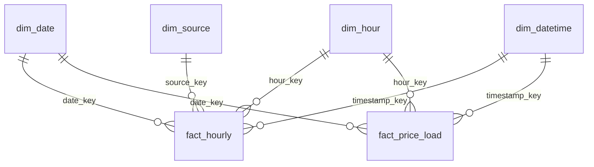

# Power BI report specification

Three report pages, one per group of business questions. All measures are defined in
[`measures.dax`](measures.dax); setup and connection steps are in [`setup_guide.md`](setup_guide.md).

**Canvas:** 16:9 (1280 × 720). **Mode:** Import (≈ 300k fact rows, refresh in seconds).

---

## Data model

| From (many) | To (one) | Cardinality | Cross-filter | Active |
|---|---|---|---|---|
| fact_hourly[date_key] | dim_date[date_key] | *:1 | Single | ✔ |
| fact_hourly[hour_key] | dim_hour[hour_key] | *:1 | Single | ✔ |
| fact_hourly[source_key] | dim_source[source_key] | *:1 | Single | ✔ |
| fact_hourly[timestamp_key] | dim_datetime[timestamp_key] | *:1 | Single | ✔ |
| fact_price_load[date_key] | dim_date[date_key] | *:1 | Single | ✔ |
| fact_price_load[hour_key] | dim_hour[hour_key] | *:1 | Single | ✔ |
| fact_price_load[timestamp_key] | dim_datetime[timestamp_key] | *:1 | Single | ✔ |

**No** relationships from dim_datetime to dim_date / dim_hour. They would create a second filter
path (fact → dim_datetime → dim_date) and make the model ambiguous. dim_datetime is used only for
the peak flag and for hour-level detail.

**Why it works across both facts:** dim_date, dim_hour and dim_datetime filter both fact tables,
so a visual can combine, for example, `Renewable Share %` (from fact_hourly) and `Avg Price` (from fact_price_load).
dim_source filters only fact_hourly; price measures ignore a source slicer, which is intended.

---

## Global design rules

- **Colours:** use one fixed colour per source on every page (Format > Colors per `dim_source[source_label]`).
  Renewables in greens/blues (wind = blue, solar = yellow, biomass = green, hydro = teal), fossil in
  greys/browns (lignite = dark brown, hard coal = dark grey, gas = light grey), nuclear = purple, pumped storage = light blue.
- **Price scale:** wherever prices are colour-coded, use a diverging scale centred on **0 €/MWh**
  (blue = negative, white = 0, red = high), so negative prices stand out.
- **Number formats:** prices `#,0.00 "€/MWh"`, shares `0.0 %`, energy `#,0.0 "TWh"`, power `#,0.0 "GW"`.
- **Slicers:** synced across all pages (View > Sync slicers): `dim_date[year]` and `dim_date[season]`.
- **Every visual title is the question it answers** (e.g. "Does more renewables mean cheaper power?").

---

## Page 1 – Overview

*Answers Q1: How has the renewable share developed, and how have prices moved?*

| # | Visual | Fields | Filters / settings | Question it answers |
|---|---|---|---|---|
| 1.1 | Text box + Card | Title text; Card: `[Selection Label]` | – | What period and selection am I looking at? |
| 1.2 | Slicer (tiles) | `dim_date[year]` | Multi-select, synced | – |
| 1.3 | Slicer (dropdown) | `dim_date[season]` | Synced | – |
| 1.4 | Card (new), 5 cards | `[Avg Price]`, `[Renewable Share %]`, `[Total Generation TWh]`, `[Total Consumption TWh]`, `[Negative Price Hours]` | Reference labels: `[Avg Price YoY %]`, `[Renewable Share YoY pp]`, `[Negative Price Hours YoY %]` | What are the headline KPIs and how did they change vs. last year? |
| 1.5 | Line chart | X: `dim_date[year_month]`; Y: `[Renewable Share %]` | Analytics: average line | How has the renewable share developed month by month? |
| 1.6 | Stacked column chart | X: `dim_date[year_month]`; Y: `[Total Generation TWh]`; Legend: `dim_source[source_label]` | Legend sorted by `dim_source[category]` | How is the generation mix changing (wind in winter, solar in summer, less fossil)? |
| 1.7 | Line chart | X: `dim_date[date]`; Y: `[Avg Price]` (thin, light grey), `[Rolling 7-Day Avg Price]` (thick) | Continuous X axis | How volatile is the price, and what is the trend without daily noise? |
| 1.8 | Table | `dim_date[year]`, `[Avg Price]`, `[Avg Price YoY %]`, `[Renewable Share %]`, `[Renewable Share YoY pp]`, `[Negative Price Hours]`, `[Negative Price Hours YoY %]` | Conditional formatting: icons on YoY columns | How do the years compare? |

---

## Page 2 – Price drivers

*Answers Q2 (how strongly renewables affect price) and Q4 (typical day, summer vs. winter).*

| # | Visual | Fields | Filters / settings | Question it answers |
|---|---|---|---|---|
| 2.1 | Scatter chart | Values/Details: `dim_date[date]`; X: `[Renewable Share %]`; Y: `[Avg Price]`; Legend: `dim_date[season]` | Analytics: trend line. One dot per **day** (1,096 points). Hourly detail (`dim_datetime[timestamp_key]`, 26k points) exceeds the 10k-point scatter limit and would be sampled. | Does a higher renewable share mean a lower price? |
| 2.2 | Clustered column chart | X: `dim_datetime[Renewable Share Bucket]`; Y: `[Avg Price]`; Tooltip: `[Hours]`, `[Negative Price Share %]` | Exclude blank bucket | How much cheaper is power when renewables cover 80–100 % vs. 0–20 %? |
| 2.3 | Matrix (heatmap) | Rows: `dim_hour[hour_label]`; Columns: `dim_date[weekday_name]`; Values: `[Avg Price]` | Conditional formatting: background colour, diverging scale centred on 0; hide totals | At which hour and weekday is power most expensive or cheapest? |
| 2.4 | Line chart | X: `dim_hour[hour_label]`; Y: `[Avg Price]`; Legend: `dim_date[season]` | Visual filter: season = Summer, Winter | How does the daily price curve differ between summer and winter (duck curve vs. two peaks)? |
| 2.5 | Line chart, small multiples | X: `dim_hour[hour_label]`; Y: `[Avg Solar GW]`, `[Avg Wind GW]`, `[Avg Load GW]`, `[Avg Residual Load GW]`; Small multiples: `dim_date[season]` | Visual filter: season = Summer, Winter | Which supply/demand pattern causes the price curve in 2.4? |
| 2.6 | Clustered column chart | X: `dim_date[year]`; Y: `[Peak Price]`, `[Off-Peak Price]` | Tooltip: `[Peak vs Off-Peak Spread]` | Is peak power still a premium product, or does solar erode it? |

---

## Page 3 – Negative prices deep dive

*Answers Q3: When and why do negative prices occur?*

| # | Visual | Fields | Filters / settings | Question it answers |
|---|---|---|---|---|
| 3.1 | Card (new), 4 cards | `[Negative Price Hours]`, `[Negative Price Share %]`, `[Avg Negative Price]`, `[Min Price]` | Reference label on first card: `[Negative Price Hours YoY %]` | How often and how deep do prices go negative? |
| 3.2 | Clustered column chart | X: `dim_date[month_name]` (sorted by `month`); Y: `[Negative Price Hours]`; Legend: `dim_date[year]` | – | In which months do negative prices occur, and is it getting more frequent? |
| 3.3 | Matrix (heatmap) | Rows: `dim_hour[hour_label]`; Columns: `dim_date[month_name]`; Values: `[Negative Price Hours]` | Conditional formatting: background, white → dark blue | At what time of day, and in which season? (midday in spring/summer vs. night in winter) |
| 3.4 | Bar chart | Y: `dim_date[Day Type]` (sorted by `Day Type Order`); X: `[Negative Price Share %]` | Data labels on | Are weekends and holidays more exposed? |
| 3.5 | Clustered column chart | X: `dim_datetime[Price Sign]`; Y: `[Avg Load GW]`, `[Avg Solar GW]`, `[Avg Wind GW]`, `[Avg Residual Load GW]` | – | **Why** – what do market conditions look like in negative hours compared with other hours? |
| 3.6 | Table | `dim_date[date]`, `dim_date[weekday_name]`, `dim_date[holiday_name]`, `[Avg Price]`, `[Renewable Share %]`, `[Negative Price Hours]` | Filter: Top N = 10 by `[Avg Price]`, **bottom** | Which were the cheapest days and what did they have in common? |
| 3.7 | Text box | 2–3 sentence takeaway written from the visuals (numbers from `docs/analysis_results.md`) | – | What is the business takeaway? |

---

## Validation checklist

After building, put these in a temporary table visual and compare with the SQL results
(`docs/analysis_results.md`). All of them must match to 2 decimals:

| Measure | Filter | Expected |
|---|---|---|
| Avg Price | year 2023 / 2024 / 2025 | 95.18 / 78.51 / 89.32 |
| Renewable Share % | year 2023 / 2024 / 2025 | 55.5 % / 58.6 % / 58.9 % |
| Negative Price Hours | year 2023 / 2024 / 2025 | 301 / 457 / 576 |
| Peak Price / Off-Peak Price | year 2025 | 92.35 / 87.64 |
| Load-Weighted Avg Price | year 2023 | 98.31 |
| Negative Price Share % | Day Type = Public holiday | 17.75 % |
| Rolling 7-Day Avg Price | date 2024-12-14 | 184.31 |
| Avg Price | Renewable Share Bucket = 80–100 % | 9.58 |
